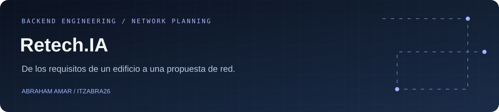

<p align="center"></p>

<p align="center">
  <a href="https://github.com/ItzAbra26/RetechIA/actions/workflows/tests.yml"></a>
  
  
  
</p>

## Una propuesta de red a partir de necesidades reales

**Retech.IA** es un MVP backend inspirado en mi proyecto ganador de hackathon. Parte de una pregunta: **¿qué infraestructura necesita un edificio y cómo distribuimos su red?**

La API recibe departamentos y cantidades de equipos, calcula subredes y genera una propuesta inicial de puntos de red, switches y racks. Une mi formación en **desarrollo de aplicaciones** con mi base en **sistemas y redes**.

> La versión actual aplica reglas y cálculos deterministas. La lectura de planos y las recomendaciones mediante IA forman parte del roadmap.

## Qué puedes hacer hoy

| Funcionalidad | Resultado |
| --- | --- |
| Distribuir una red IPv4 | Subredes ordenadas por la necesidad de hosts de cada departamento |
| Comprobar capacidad | Rechazo de propuestas que no caben en la red base |
| Consultar cada subred | Dirección de red, CIDR, primer y último host, broadcast y capacidad |
| Estimar una instalación | Puntos de red, switches de 24 puertos y racks por planta |
| Integrar otra interfaz | Dos endpoints REST con entrada y salida JSON |

## Ejemplo: un edificio con tres departamentos

```http
POST /api/network/subnets
Content-Type: application/json
```

```json
{
  "baseNetwork": "192.168.10.0/24",
  "departments": [
    { "name": "Administración", "hosts": 28 },
    { "name": "Urgencias", "hosts": 52 },
    { "name": "Servidores", "hosts": 12 }
  ]
}
```

El plan asigna primero el bloque más grande:

| Departamento | Red asignada | Hosts utilizables |
| --- | --- | --- |
| Urgencias | 192.168.10.0/26 | 62 |
| Administración | 192.168.10.64/27 | 30 |
| Servidores | 192.168.10.96/28 | 14 |

Para obtener también la propuesta del edificio:

```http
POST /api/planning/building-proposal
Content-Type: application/json
```

```json
{
  "buildingName": "Centro de demostración",
  "floors": 2,
  "baseNetwork": "192.168.10.0/24",
  "departments": [
    { "name": "Administración", "hosts": 28 },
    { "name": "Urgencias", "hosts": 52 },
    { "name": "Servidores", "hosts": 12 }
  ]
}
```

Para este ejemplo, la estimación es de **115 puntos de red, 5 switches y 2 racks**. Las reglas actuales añaden un 25 % de margen sobre los hosts, calculan switches de 24 puertos y proponen un rack por planta. Son estimaciones orientativas, no un proyecto de ingeniería validado.

## Puesta en marcha

Necesitas **JDK 21 o superior y Maven 3.9**.

```bash
git clone https://github.com/ItzAbra26/RetechIA.git
cd RetechIA
mvn test
mvn spring-boot:run
```

La API escucha en `http://localhost:8080`. Puedes probar los ejemplos desde Postman, Insomnia o cualquier cliente HTTP.

## Organización del código

```text
com.retechia.api
├── network   Cálculo IPv4, planificación y endpoint de subredes
├── planning  Estimación de infraestructura y endpoint de edificios
└── common    Respuestas de error para peticiones inválidas
```

Los controladores reciben peticiones con Bean Validation; los servicios contienen las reglas de planificación. Los tests comprueban la asignación de subredes, las redes insuficientes y los casos extremos que antes podían desbordar el cálculo de hosts.

## Estado y próximos pasos

- **Implementado:** cálculo IPv4, API REST, estimaciones básicas y pruebas unitarias.
- **Siguiente:** ampliar validaciones y pruebas de integración y documentar la API con OpenAPI.
- **Evolución:** importación de planos, visualización de la topología, presupuesto e integración de IA.

Este MVP no incluye autenticación ni límites de uso. Antes de exponerlo como servicio público hay que añadir esos controles y revisar sus dependencias y capacidad.

## Autor

**Abraham Amar Bentolila** · Desarrollador en formación DAM, con base en sistemas y redes.

[GitHub](https://github.com/ItzAbra26) · [LinkedIn](https://www.linkedin.com/in/abraham-amar-bentolila-61bb75277/) · [Contacto](mailto:abrahamamar26@gmail.com)
